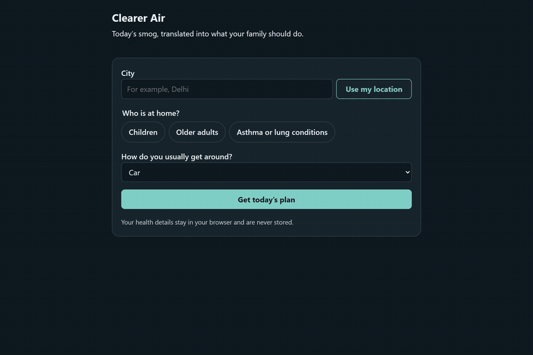

# Clearer Air — Urban Air Quality Assistant (Challenge 6)

**Vertical:** families and communities facing severe winter smog.

## Approach and logic
1. Live US AQI comes from Open-Meteo (no key, free) for the chosen city or device location.
2. `src/logic.js` (pure, unit-tested) turns AQI + household (children, older adults, lung conditions) + commute into a ranked plan. Sensitive households are advised one band worse.
3. Every action explains **For you** (health effect) and **For the air** (what it avoids, e.g. ~1.7 kg CO₂ per 10 km car trip skipped, an estimate).
4. `api/advice.js` optionally asks Gemini for a 60-word plain-language summary. Without a key, or on any failure, the rule-based plan still works.

## Quality notes
- **Security:** strict CSP + security headers (`vercel.json`), allow-list validation (`src/validate.js`), no `innerHTML`, API key server-side only, rate limit, timeouts. Health details are never stored.
- **Accessibility:** semantic form, labels, skip link, `aria-live` results, focus management, 44 px targets, colour never the only signal, dark mode, reduced motion.
- **Efficiency:** zero dependencies, no build step, ~15 KB total.
- **Testing:** `npm test` (Node built-in runner).

## Run and deploy
`npm test` · `npx vercel dev` · push to GitHub and import into Vercel. Optional env: `GEMINI_API_KEY`, `GEMINI_MODEL`.

## Assumptions
US AQI scale; AQI is a model estimate, not a medical diagnosis; advice is general guidance.
